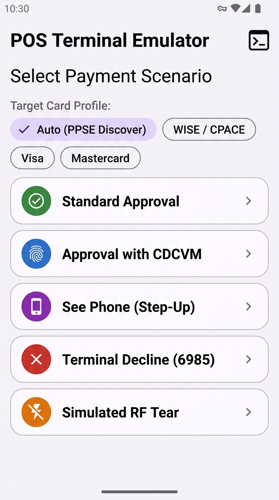
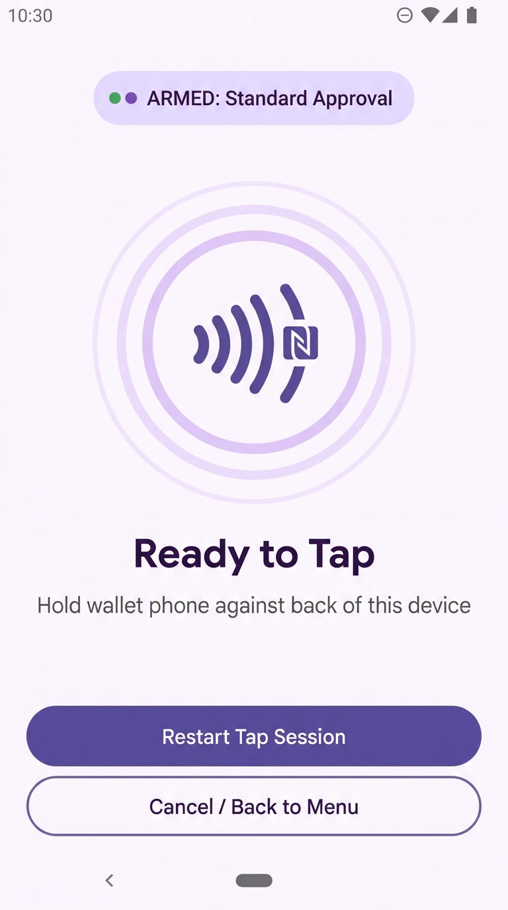
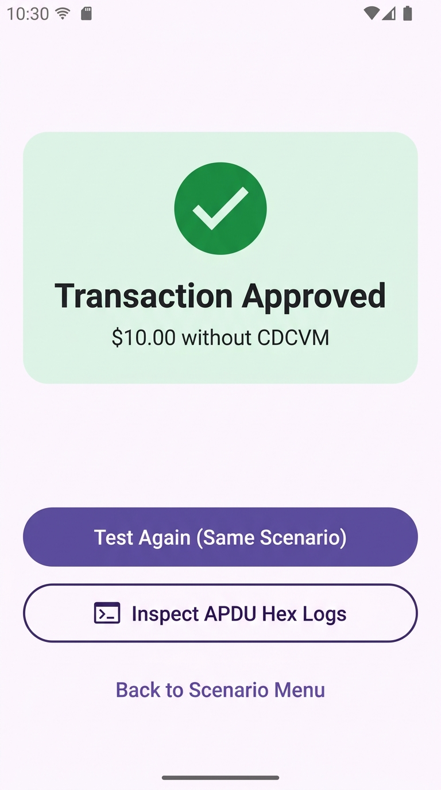

# NFC POS Terminal Emulator (`nfcEmulator`)

A developer tool and Android application designed to emulate an EMV Point-of-Sale (POS) contactless reader. Built to thoroughly test NFC mobile wallets (Apple Pay, Google Wallet, custom HCE wallets) across realistic terminal scenarios, step-ups, declines, and failure recovery.

---

## 📱 Screenshots

  
  &nbsp;&nbsp;&nbsp;&nbsp;
  
  &nbsp;&nbsp;&nbsp;&nbsp;
  

---

## ✨ Features

- **Standard Contactless EMV Engine**: Implements ISO/IEC 7816-4 APDU commands, PPSE selection (`2PAY.SYS.DDF01`), dynamic AID negotiation, and GPO (`GET PROCESSING OPTIONS`).
- **Broad Scheme & Standard Support**:
  - **Major Schemes**: Visa (`A0000000031010`) & Mastercard (`A0000000041010`).
  - **Domestic & White Label**: IDEMIA WISE, White Label Alliance (WLA), and European CPACE (`A0000008430101`, `A0000008580101`) with dynamic PPSE auto-discovery and direct AID selection.
  - **Card Profile Selector**: Toggle between **Auto (PPSE Discover)**, **WISE / CPACE**, **Visa**, and **Mastercard** at the top of the screen to execute *any* test scenario against that specific card technology.
- **One-Tap Test Scenarios**:
  1. **Standard Approval**: Normal contactless payment with online cryptogram request (`9000`).
  2. **Approval with CDCVM**: Signals Terminal Transaction Qualifiers (TTQ) requiring Consumer Device Cardholder Verification Method (biometric unlock / device passcode).
  3. **"See Phone" Step-Up**: Simulates terminal instructing the cardholder to verify their identity on their phone and re-tap (supported across all schemes, including WISE / CPACE!).
  4. **Terminal Decline (`6985`)**: Terminal aborts with Status Word `69 85` (Conditions of use not satisfied).
  5. **Cryptogram Decline (`AAC`)**: Generates an Application Authentication Cryptogram (AAC) decline.
  6. **Simulated RF Tear**: Prematurely drops the connection mid-flight (`isoDep.close()`) to test wallet resilience to tap-and-pull edge cases.
  7. **Terminal Stall / Timeout**: Holds the RF field open with an artificial delay to test wallet timeout handling.
  8. **Unsupported Card**: Refuses the credential with `6A 82` (Application not found).
- **Fail-Safe Testing UX**:
  - Direct controls for **"Restart Tap Session"** and **"Cancel / Back to Menu"** so an unstable wallet build never locks up the testing device.
- **Raw APDU Hex Inspector**:
  - Live modal sheet showing every command and response APDU byte array and status words for debugging.

---

## 📦 Releases & APK Downloads

Pre-built APKs are automatically generated for each release and build:

- **Latest Stable Release**: Download `app-debug.apk` directly from the [GitHub Releases](https://github.com/sergitorralba/nfcEmulator/releases) page.
- **Continuous Integration**: Every push to `main` compiles an APK artifact accessible under the [GitHub Actions](https://github.com/sergitorralba/nfcEmulator/actions) tab.

---

## 🛠 Tech Stack

- **Platform**: Android (`minSdk 26`, `compileSdk 34`)
- **Language**: Kotlin 2.0+
- **UI**: Jetpack Compose + Material 3
- **NFC Engine**: `NfcAdapter.enableReaderMode` + `IsoDep.transceive()`
- **Architecture**: Clean Architecture + MVI (`PosViewModel` $\to$ `NfcTerminalManager` $\to$ `ScenarioExecutor`)

---

## 🚀 Getting Started

1. Open this project in **Android Studio Ladybug (or newer)**.
2. Ensure you run this app on a **physical Android device with NFC hardware**.
3. Open the app, select any scenario from the home screen, and hold your wallet device against the back of the phone.
